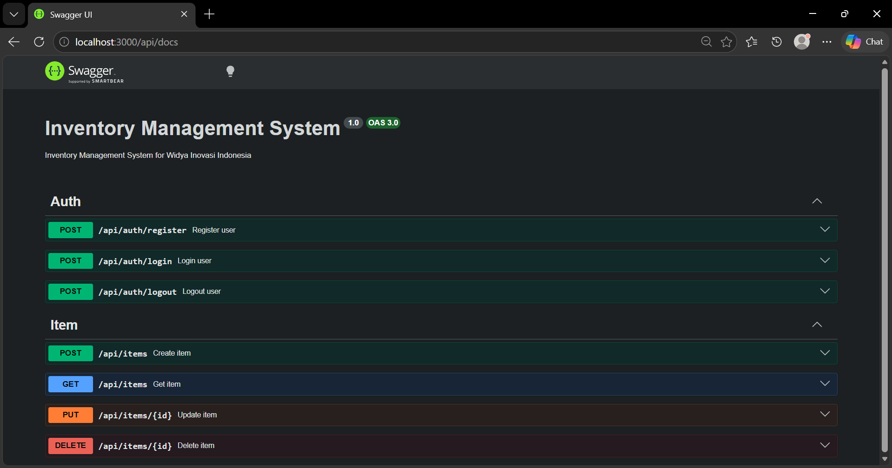
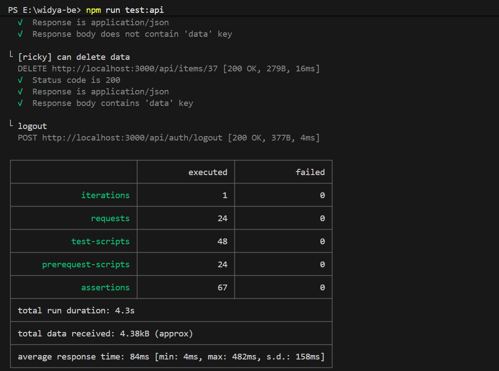

# Inventory Management System



## Tech Stack

- NestJS
- PostgreSQL

## How to Install

1. Clone repository

```bash
git clone https://github.com/getallineedeasily/widya-be.git
```

2. Open directory

```bash
cd widya-be
```

3. Install dependencies

```bash
npm install
```

4. Create an `.env` file based on the `.env.example` file and fill in the value

5. Run migration and seeders (Make sure you already have a database)

```bash
npm run migrate up
npm run seed
```

6. Run the application

```bash
npm run start:dev
```

7. Run the API test

```bash
npm run test:api
```

8. Documentation is available on `http://localhost:3000/api/docs`

## Questions

1. Alur Request: Jelaskan alur perjalanan sebuah request dari saat API dipanggil oleh client hingga data tersimpan di database. (Misal: Router -> Middleware -> Controller -> Service -> Repository). Mengapa Anda memisahkan logic seperti itu? <br>

Pada test ini, saya mengimplementasikan alur request sebagai berikut:
Request > Guard > Controller > Service > Repository > Database.

- Guard bertugas memeriksa request sebelum diteruskan ke controller, misalnya memvalidasi apakah pengguna sudah terautentikasi.
- Controller bertanggung jawab menangani HTTP request dan response.
- Service menangani business logic.
- Repository bertanggung jawab terhadap interaksi dengan database.

Saya memisahkan tanggung jawab tersebut untuk menerapkan Separation of Concerns sehingga kode lebih mudah dipelihara, dikembangkan, dan diuji. Selain itu, pemisahan ini mempermudah proses debugging karena setiap layer memiliki tanggung jawab yang spesifik.

2. Keamanan & Token: Dimana sebaiknya frontend menyimpan token JWT yang dikembalikan oleh API ini (Local Storage atau HttpOnly Cookie)? Apa alasan dan risiko keamanannya? <br>

Saya lebih memilih Httponly Cookie karena token JWT tidak dapat diakses secara langsung melalui JavaScript, sehingga mengurangi risiko pencurian token melalui serangan XSS.

Cookie juga dapat dikonfigurasi menggunakan atribut Secure dan SameSite untuk meningkatkan keamanan pengiriman token.

Sementara itu, Local Storage memungkinkan token diakses melalui JavaScript sehingga lebih rentan apabila aplikasi mengalami serangan XSS.

3. Penanganan Konkurensi (Concurrency): Misalkan API Anda dipublish ke publik, lalu ada 2 user yang secara TEPAT BERSAMAAN melakukan request untuk mengurangi stok barang X (stok tersisa: 1). Bagaimana cara Anda mencegah stok menjadi -1 di database? <br>

Saya akan menggunakan atomic update dengan menambahkan kondisi stock > 0 pada query UPDATE seperti berikut:

```sql
update items
set stock=stock-1
where id=$1 and stock > 0
```

Dengan demikian, pengecekan stok dan pengurangan stok dilakukan dalam satu operasi database sehingga mencegah race condition yang dapat menyebabkan stok menjadi negatif.

Selain itu, saya akan menambahkan CHECK constraint pada database untuk memastikan nilai stock tidak pernah kurang dari 0 sebagai lapisan perlindungan tambahan seperti berikut:

```sql
alter table items
add constraint check_stock check (stock >= 0);
```

## Screenshots


